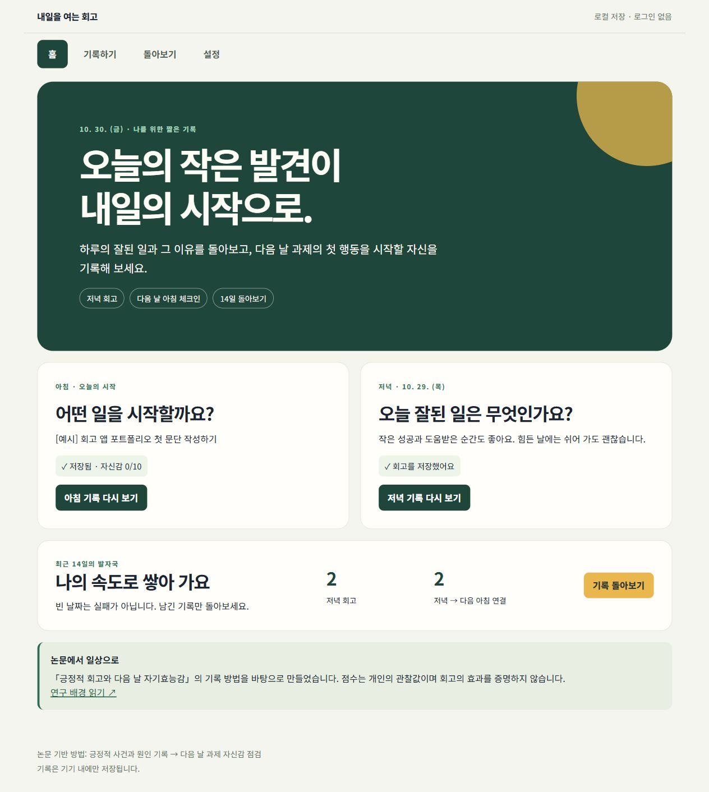
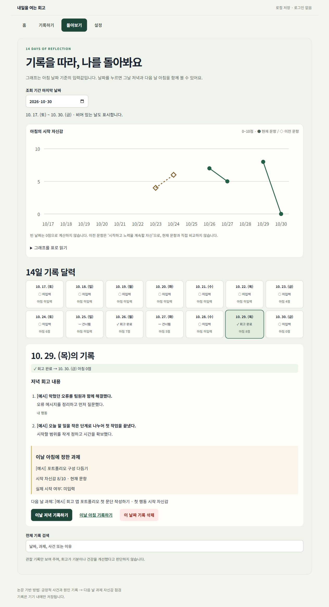
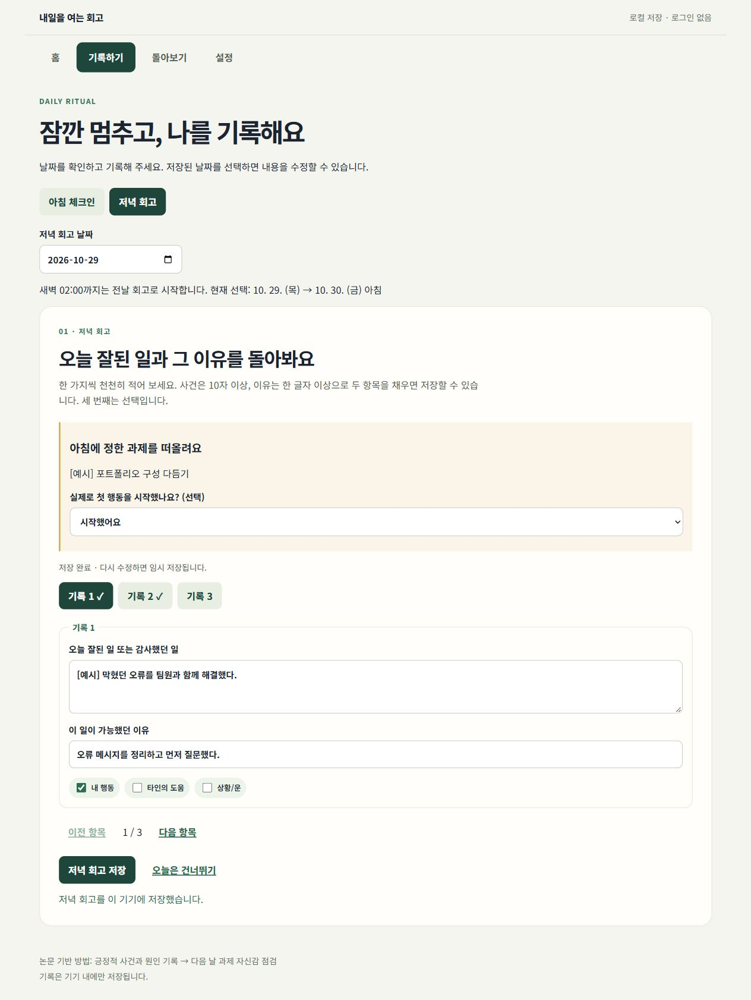
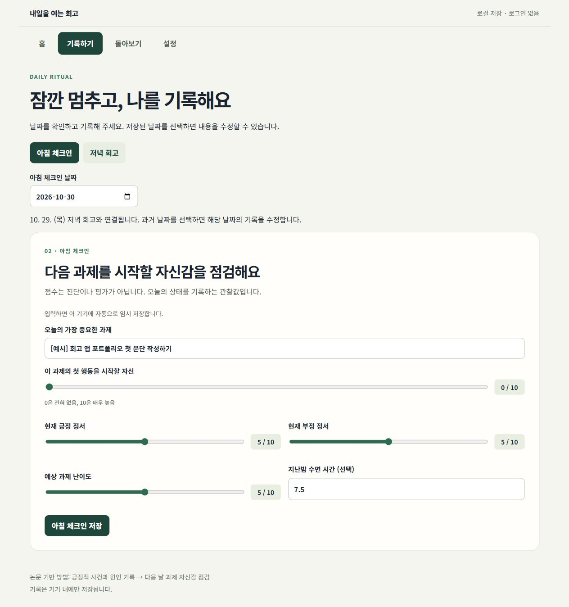

# 내일을 여는 회고

### 연구 질문을 일상 속 기록 경험으로 구현한 React 웹앱

저녁의 긍정적 사건과 이유를 기록하고, 다음 날 과제를 시작할 자신감을 돌아보는 개인 프로젝트입니다. **관련 문헌을 검토한 30페이지 연구 논문(문헌고찰·연구 프로토콜)을 함께 작성하고, 기록 절차를 웹앱으로 구현했습니다.**

[웹앱 열기](https://retrospective-that-opens-up-tomorro.vercel.app/) · [앱 GitHub](https://github.com/gyeonggumun/retrospective-that-opens-up-tomorrow) · [논문 읽기](https://positive-reflection-research-paper.vercel.app/) · [논문 PDF](https://positive-reflection-research-paper.vercel.app/paper.pdf) · [논문 GitHub](https://github.com/gyeonggumun/positive-reflection-research-paper)

| 구분 | 내용 |
| --- | --- |
| 프로젝트 형태 | 개인 프로젝트 · SKT 알래프 과제에서 출발한 연구 기반 자기관찰 도구 |
| 역할 | 기획, 연구 질문·기록 기준 설계, AI를 활용한 React 구현 및 검증, 문서화 |
| 기술 | React 19, JavaScript, Vite 7, CSS, SVG, localStorage, Node.js 테스트, GitHub Actions, Vercel |
| 결과물 | 공개 웹앱, 소스 저장소, 논문 웹판·PDF, 화면 증빙과 검증 문서 |
| 구현 원칙 | 로컬 저장, 사용자 통제권, 기록과 해석의 구분, 기존 디자인 유지 |

> 아래 앱 캡처는 실제 화면을 촬영한 것으로, `[예시]`가 붙은 가상 기록을 사용했습니다. 그래프는 연구 효과를 검증한 실험 결과가 아닙니다. 캡처일: 2026. 10. 30.

## 핵심 교훈 · Key Takeaways

- **연구의 개념을 그대로 화면에 옮길 수는 없었습니다.** 자기효능감의 범위를 ‘과제의 첫 행동을 시작할 자신’으로 좁히고, 문항 변경 전후 기록을 구분했습니다.
- **기록의 연결 기준도 기능의 일부였습니다.** 같은 날짜에 저녁과 아침을 묶던 구조를 저녁 D → 다음 날 아침 D+1로 수정했습니다.
- **비어 있는 값은 의미가 있었습니다.** 0점·미입력·건너뜀·임시 저장을 나누고, 누락 구간을 그래프 선으로 이어 붙이지 않았습니다.
- **완성도는 예외 상황에서 드러났습니다.** 저장 실패, 손상 데이터, 다른 탭의 변경, 백업 복원 충돌까지 다뤘습니다.

## 프로젝트 목표

교육 중 리추얼에서 하는 짧은 회고를 일상에서도 반복할 수 있도록, 작성·저장·다음 날 점검·돌아보기의 흐름을 하나의 앱으로 연결했습니다. 중요한 목표는 점수를 높이게 만드는 것이 아니라, 사용자가 자신의 기록을 남기고 확인하며 관리할 수 있게 하는 것이었습니다.

| 홈 · 오늘의 기록 상태와 다음 행동 | 돌아보기 · 14일 추이와 날짜 연결 |
| --- | --- |
|  |  |

## 역할 및 시도 · My Role & Attempts

### 1. 논문 작성과 제품 설계 연결

「대학생의 저녁 긍정적 회고와 다음 날 과제 시작 자기효능감의 시간적 연관성」을 문헌고찰과 연구 프로토콜 형식으로 작성했습니다. 한국어 확장본은 30페이지이며, 도식·이미지 7개, 표 11개, 참고문헌 11편과 부록을 포함합니다.

논문에서는 14일 일상기록 설계, 기록 시점, 결측 분류, 개인 내·개인 간 차이, 혼합모형을 이용한 분석 계획과 한계를 다뤘습니다. 앱에는 그중 실제 개인 기록에 필요한 문항·날짜 연결·데이터 구분을 반영했습니다.

**현재 논문은 실증자료 수집 전 단계의 연구 프로토콜입니다. 학술지 게재나 효과 검증을 완료한 연구로 표현하지 않습니다.**

### 2. 부담을 줄이는 기록 흐름

회고는 한 항목씩 작성하고, 사건·이유·기여 태그를 함께 남기도록 구성했습니다. 두 항목 이상이면 완료할 수 있고 세 번째는 선택입니다. 입력 중에는 자동으로 임시 저장해 새로고침 후에도 이어 쓸 수 있게 했습니다.

아침에는 중요한 과제와 시작 자신감, 정서·난이도·수면을 기록합니다. 저녁에는 아침에 정한 과제를 다시 보여 주고 실제 시작 여부를 선택적으로 남기게 했습니다.

| 저녁 · 항목별 작성과 과제 되돌아보기 | 아침 · 시작 자신감 점검 |
| --- | --- |
|  |  |

### 3. 데이터 의미를 보존하는 시각화

- 14개 기록이 아닌 **14개의 실제 날짜**를 표시했습니다.
- 미입력은 그래프에서 비워 두고, 관측된 0점은 실제 점으로 표시했습니다.
- 회고 완료·건너뜀·미입력을 문자와 기호로 구분했습니다.
- 현재 문항은 원형, 이전 문항은 마름모·점선으로 구분하고 다른 버전 사이를 연결하지 않았습니다.
- 그래프를 표로 읽는 기능, 날짜 상세, 전체 기록 검색과 수정 진입을 제공했습니다.

### 4. 기록 관리와 배포 검증

외부 계정이나 데이터베이스 없이 브라우저 안에 기록을 저장했습니다. JSON 백업은 작성 중인 내용까지 담고, 복원은 파일 검증·미리보기·기존 내용 우선 병합 순서로 처리합니다. CSV에는 다음 날 연결과 문항 버전 정보를 추가했습니다.

기존 v1 저장 데이터를 읽을 때는 날짜를 이동하지 않고, 새로운 저장에 성공한 뒤 저장소 버전을 전환했습니다. GitHub Actions에 테스트·빌드를 추가하고 GitHub push → Vercel 자동 배포 흐름을 사용합니다.

## 직면한 과제와 배운 점 · Challenges & Key Learnings

| 과제 | 해결한 방법 | 배운 점 |
| --- | --- | --- |
| 같은 날짜의 저녁·아침이 연결돼 다음 날 관찰이라는 의미가 흐려짐 | 실제 날짜는 보존하고 조회·CSV에서 D → D+1 관계를 계산 | 시간의 의미를 데이터 모델에 반영해야 함 |
| 문항을 고치면 이전 점수도 같은 척도처럼 보일 위험 | 현재·이전 문항 버전을 저장하고 그래프 표시를 구분 | 기존 데이터의 해석을 소급 변경하면 안 됨 |
| 빈 날짜와 0점이 혼동될 수 있음 | 완료·건너뜀·누락·임시 저장을 분리하고 누락 구간을 연결하지 않음 | 보기 좋은 그래프보다 정확한 표현이 우선임 |
| 로컬 저장만으로는 데이터 이동과 복구가 어려움 | JSON 백업·복원, CSV 내보내기, 손상 원본 다운로드 | 개인정보 최소화와 데이터 이동성을 함께 설계할 수 있음 |
| 여러 탭이 서로의 기록을 덮어쓸 수 있음 | 저장 버전 비교와 변경 알림으로 오래된 탭의 쓰기 차단 | 저장 성공 여부를 사용자에게 정확히 전달해야 함 |

## 확인한 결과와 피드백

- 날짜 경계, 데이터 이전, 손상·용량 부족·충돌, 백업 병합, CSV 의미 보존에 대한 **자동 테스트 8개 통과**.
- 브라우저에서 입력 오류, 임시 저장 복원, 저녁 → 다음 아침 연결, 검색, 백업 미리보기·복원·다운로드를 확인했습니다.
- 모바일 화면에서 페이지 전체의 가로 넘침이 없는 것을 확인하고, 그래프 영역에만 가로 스크롤을 제공했습니다.
- 상세 검증 범위와 증빙은 [검증 기록](docs/VERIFICATION.md)에 정리했습니다.

사용자가 전달한 팀원 리뷰:

> “SKT 알래프 교육중에 하는 리추얼시간에 하는 것과 같아서 좋은 것 같다, 앱으로 사용가능해서 효율적이어 보인다”

이 피드백을 사용 맥락과 편의성에 대한 정성 의견으로 받아들였습니다. 사용 시간 감소나 심리적 효과를 입증한 수치로 해석하지 않았습니다.

| 모바일 홈 | 모바일 돌아보기 |
| --- | --- |
|  |  |

## AI 활용과 직접 판단

AI를 활용해 컴포넌트와 문서 초안을 작성하고, 입력 검증·데이터 관리·테스트 구현을 보완했습니다. 프로젝트의 사용자, 기록 기준, 논문과 앱의 연결 범위, 개인정보 최소화 방향을 정하고 생성된 결과를 검토하는 방식으로 진행했습니다.

자동 진단, 근거 없는 효과 점수, 연속 기록 경쟁 대신 사용자가 기록하고 쉬어 갈 수 있는 흐름을 선택했습니다. 연구 데이터 수집이나 임상적 판단 기능은 현재 앱에 포함하지 않았습니다.

## 후속 발전 방향

실제 사용성 평가를 통해 작성 단계와 문구를 조정할 수 있습니다. 연구용으로 확장할 때에는 동의·철회, 참여자 코드, 수집 절차, 연구윤리 검토를 별도로 준비하고 개인 기록 기능과 구분할 계획입니다.
