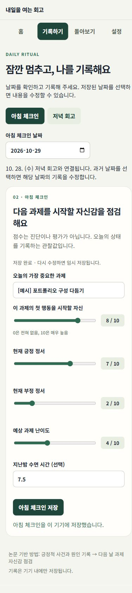

# 내일을 여는 회고

### 연구 질문을 일상 속 기록 경험으로 구현한 React 웹앱

저녁의 긍정적 사건과 이유를 기록하고, 다음 날 과제를 시작할 자신감을 돌아보는 개인 프로젝트입니다. **관련 문헌을 검토한 30페이지 연구 논문(문헌고찰·연구 프로토콜)을 함께 작성하고, 기록 절차를 웹앱으로 구현했습니다.**

[웹앱 열기](https://retrospective-that-opens-up-tomorro.vercel.app/) · [앱 GitHub](https://github.com/gyeonggumun/retrospective-that-opens-up-tomorrow) · [논문 읽기](https://positive-reflection-research-paper.vercel.app/) · [논문 PDF](https://positive-reflection-research-paper.vercel.app/paper.pdf) · [논문 GitHub](https://github.com/gyeonggumun/positive-reflection-research-paper)

| 구분 | 내용 |
| --- | --- |
| 프로젝트 형태 | 개인 기획·연구·개발 프로젝트 · 연구 기반 자기관찰 도구 |
| 역할 | 기획, 연구 질문·기록 기준 설계, AI를 활용한 React 구현 및 검증, 문서화 |
| 기술 | React 19, JavaScript, Vite 7, CSS, SVG, localStorage, Node.js 테스트, GitHub Actions, Vercel |
| 결과물 | 공개 웹앱, 소스 저장소, 논문 웹판·PDF, 화면 증빙과 검증 문서 |
| 구현 원칙 | 로컬 저장, 사용자 통제권, 기록과 해석의 구분, 일관된 사용 흐름 |

> 아래 앱 캡처는 실제 화면을 촬영한 것으로, `[예시]`가 붙은 가상 기록을 사용했습니다. 그래프는 연구 효과를 검증한 실험 결과가 아닙니다. 캡처일: 2026. 10. 30.

## 핵심 교훈 · Key Takeaways

- **연구의 개념을 그대로 화면에 옮길 수는 없었습니다.** 자기효능감의 범위를 ‘과제의 첫 행동을 시작할 자신’으로 좁히고, 문항 변경 전후 기록을 구분했습니다.
- **기록의 연결 기준도 기능의 일부였습니다.** 같은 날짜에 저녁과 아침을 묶던 구조를 저녁 D → 다음 날 아침 D+1로 수정했습니다.
- **비어 있는 값은 의미가 있었습니다.** 0점·미입력·건너뜀·임시 저장을 나누고, 누락 구간을 그래프 선으로 이어 붙이지 않았습니다.
- **완성도는 예외 상황에서 드러났습니다.** 저장 실패, 손상 데이터, 다른 탭의 변경, 백업 복원 충돌까지 다뤘습니다.

## 프로젝트 목표

교육 중 리추얼에서 하는 짧은 회고를 일상에서도 반복할 수 있도록, 작성·저장·다음 날 점검·돌아보기의 흐름을 하나의 앱으로 연결했습니다. 사용자가 작은 성공을 구체적으로 기록하고, 날짜별로 확인하며, 자신의 데이터를 직접 관리할 수 있는 경험을 목표로 했습니다.

## 역할 및 구현 범위

문헌 검토와 연구 질문 정리부터 문항·날짜 기준 설계, React 화면 구성, 브라우저 저장과 파일 관리, 실제 사용 흐름 검증까지 진행했습니다. AI로 구현 초안을 만들고 결과를 확인하며 보완했습니다.

사용 흐름은 **홈에서 상태 확인 → 저녁 회고·아침 체크인 → 기록 돌아보기 → 백업·관리**로 구성했습니다.

## 관련 연구 논문 제작

「대학생의 저녁 긍정적 회고와 다음 날 과제 시작 자기효능감의 시간적 연관성」을 문헌고찰과 연구 프로토콜 형식으로 작성했습니다. 한국어 확장본은 30페이지이며, 도식·이미지 7개, 표 11개, 참고문헌 11편과 부록을 포함합니다.

논문에서는 14일 일상기록 설계, 기록 시점, 결측 분류, 개인 내·개인 간 차이, 혼합모형을 이용한 분석 계획과 한계를 다뤘습니다. 앱에는 그중 실제 개인 기록에 필요한 문항·날짜 연결·데이터 구분을 반영했습니다.

**문헌고찰·연구 프로토콜 단계의 논문으로, 실증자료 수집과 효과 검증은 후속 연구 범위입니다.**

## 주요 기능과 실제 화면

### 01. 홈 — 오늘 할 기록과 최근 활동 확인

아침 체크인과 저녁 회고의 저장 상태를 구분하고, 각 기록 화면으로 바로 이동할 수 있게 했습니다. 최근 14일의 회고 횟수와 저녁 → 다음 아침 연결 횟수를 함께 보여 줍니다.

**캡처에서 볼 부분:** 아침·저녁 카드의 완료 표시, 다시 보기 버튼, 최근 14일 요약.

### 02. 저녁 회고 — 사건과 이유를 한 항목씩 작성

잘된 일과 그 이유를 기록하고, ‘내 행동·타인의 도움·상황/운’ 태그를 선택합니다. 항목 전환으로 한 번에 하나씩 작성하며, 사건 10자 이상과 이유를 갖춘 두 항목을 채우면 완료할 수 있습니다. 세 번째 항목은 선택입니다.

**캡처에서 볼 부분:** 기록 1·2·3 전환, 사건·이유 입력, 기여 태그, 저장 완료 안내.

### 03. 아침 체크인 — 중요한 과제와 시작 자신감 기록

오늘의 중요한 과제와 ‘첫 행동을 시작할 자신’을 0–10점으로 기록합니다. 정서와 예상 난이도, 선택적 수면 시간도 함께 남깁니다. 0점은 유효한 응답으로 저장하며 미입력과 구분합니다.

**캡처에서 볼 부분:** 과제 입력, 자신감 0점, 상태 슬라이더, 수면 시간, 저장 성공 안내.

### 04. 아침 목표 되돌아보기 — 실제 시작 여부 확인

저녁 회고에 그날 아침의 과제를 다시 보여 주고, 실제로 첫 행동을 시작했는지 선택적으로 기록하게 했습니다. 아침에 예상한 자신감과 실제 행동에 관한 자기보고를 구분해 보관합니다.

**캡처에서 볼 부분:** 아침 과제 재표시와 ‘시작했어요’ 선택 상태.

### 05. 자동 임시 저장 — 새로고침 후 이어 쓰기

입력할 때마다 작성 중인 내용을 브라우저에 임시 저장합니다. 페이지를 새로고침한 뒤 같은 날짜를 열면 이어 쓸 수 있으며, 저장 버튼으로 확정하기 전까지 완료 횟수에는 포함하지 않습니다.

**캡처에서 볼 부분:** 새로고침 후 복원된 입력과 ‘작성 중인 내용을 불러왔습니다’ 안내.

### 06. 날짜 연결과 상세 기록 — 저녁 D에서 아침 D+1로

달력의 날짜를 선택하면 그날 저녁 회고와 다음 날 아침 자신감을 함께 볼 수 있습니다. 새벽 02:00까지는 전날 저녁을 기본 날짜로 선택하고, 기록 날짜와 실제 저장 시각은 따로 보관합니다. 상세 화면에서는 해당 날짜의 아침·저녁 수정 화면으로 이동할 수 있습니다.

**캡처에서 볼 부분:** 10월 29일 저녁 → 10월 30일 아침 0점 연결, 회고 내용, 시작 여부와 수정 버튼.

### 07. 자신감 그래프 — 누락과 문항 버전까지 표현

14개의 실제 날짜를 기준으로 아침 자신감을 보여 줍니다. 미입력 날짜에는 점을 그리지 않고 선도 끊습니다. 현재 문항은 원형, 이전 문항은 마름모와 점선으로 구분하며 서로 다른 버전의 점수 사이를 연결하지 않습니다.

**캡처에서 볼 부분:** 비어 있는 날짜, 실제 0점, 이전·현재 문항을 구분한 기호와 선.

그래프 아래의 ‘표로 읽기’를 펼치면 날짜별 점수, 미입력 여부, 문항 종류를 텍스트로 확인할 수 있습니다.

### 08. 14일 기록 달력 — 완료·건너뜀·미입력 구분

최근 14일의 기록 상태를 날짜별로 보여 줍니다. 저녁 상태와 그날 아침 점수를 함께 표시하고, 색상 외에도 문자와 기호로 상태를 구분했습니다.

**캡처에서 볼 부분:** ‘✓ 회고 완료’, ‘— 건너뜀’, ‘○ 미입력’과 아침 점수 표시.

### 09. 전체 기록 검색 — 날짜와 내용으로 다시 찾기

날짜·과제·사건·이유를 대상으로 저장된 전체 기록을 검색합니다. 검색 결과를 누르면 해당 날짜를 선택하고 상세 내용을 확인하거나 수정할 수 있습니다.

**캡처에서 볼 부분:** ‘막혔던’ 검색어와 일치하는 날짜의 기록 1개.

### 10. JSON 백업과 CSV 내보내기 — 기록을 직접 보관

JSON은 작성한 내용과 임시 저장을 백업하고, CSV는 저장을 마친 기록을 표 형태로 내보냅니다. CSV에는 다음 날 연결과 문항 버전을 포함하고, 누락 값은 빈칸으로 남깁니다.

**캡처에서 볼 부분:** 용도가 다른 JSON 백업·CSV 내보내기 버튼과 안내.

### 11. 백업 복원 — 확인 후 기존 기록과 병합

선택한 파일의 형식을 검증한 뒤 기록·임시 저장 개수를 먼저 보여 줍니다. 사용자가 복원을 확정하면 현재 내용과 합치며, 같은 날짜의 기존 아침·저녁 내용과 임시 저장을 우선 보존합니다.

**캡처에서 볼 부분:** 선택한 JSON 파일, 기록 개수, 복원 확정·취소 버튼.

### 12. 입력 오류 안내와 건너뛰기 — 상황에 맞게 기록

아침 과제나 회고 내용이 부족하거나 수면 시간이 범위를 벗어나면 안내를 표시하고 입력 내용을 유지합니다. 회고가 어려운 날에는 건너뛰기를 선택할 수 있고, 이를 미입력이나 완료와 별도로 저장합니다.

| 부족한 입력 안내 | 회고 건너뛰기 저장 |
| --- | --- |
|  |  |

### 13. 기록 삭제 — 보관 범위를 사용자가 선택

날짜 상세에서 선택한 날짜의 아침·저녁 기록을 삭제하거나, 설정에서 기록과 임시 저장을 전체 삭제할 수 있습니다. 삭제 전에 확인창을 거치고 필요한 데이터를 먼저 백업하도록 안내합니다.

**캡처에서 볼 부분:** 설정의 전체 삭제 버튼과 백업 안내. 캡처를 위해 실제 사용자 기록을 삭제하지 않았습니다.

## 직면한 과제와 배운 점 · Challenges & Key Learnings

| 과제 | 해결한 방법 | 배운 점 |
| --- | --- | --- |
| 같은 날짜의 저녁·아침이 연결돼 다음 날 관찰이라는 의미가 흐려짐 | 실제 날짜는 보존하고 조회·CSV에서 D → D+1 관계를 계산 | 시간의 의미를 데이터 모델에 반영해야 함 |
| 문항을 고치면 이전 점수도 같은 척도처럼 보일 위험 | 현재·이전 문항 버전을 저장하고 그래프 표시를 구분 | 기존 데이터의 해석을 소급 변경하면 안 됨 |
| 빈 날짜와 0점이 혼동될 수 있음 | 완료·건너뜀·누락·임시 저장을 분리하고 누락 구간을 연결하지 않음 | 보기 좋은 그래프보다 정확한 표현이 우선임 |
| 로컬 저장만으로는 데이터 이동과 복구가 어려움 | JSON 백업·복원, CSV 내보내기, 손상 원본 다운로드 | 개인정보 최소화와 데이터 이동성을 함께 설계할 수 있음 |
| 여러 탭이 서로의 기록을 덮어쓸 수 있음 | 저장 버전 비교와 변경 알림으로 오래된 탭의 쓰기 차단 | 저장 성공 여부를 사용자에게 정확히 전달해야 함 |

## 확인한 결과와 피드백

- 날짜 경계, 데이터 이전, 손상·용량 부족·충돌, 백업 병합, CSV 의미 보존에 대한 **자동 테스트 8개 통과**.
- 브라우저에서 입력 오류, 임시 저장 복원, 저녁 → 다음 아침 연결, 검색, 백업 미리보기·복원·다운로드를 확인했습니다.
- 모바일 화면에서 페이지 전체의 가로 넘침이 없는 것을 확인하고, 그래프 영역에만 가로 스크롤을 제공했습니다.
- 상세 검증 범위와 증빙은 [검증 기록](docs/VERIFICATION.md)에 정리했습니다.

팀원에게 받은 피드백:

> “SKT 알래프 교육중에 하는 리추얼시간에 하는 것과 같아서 좋은 것 같다, 앱으로 사용가능해서 효율적이어 보인다”

이 피드백을 사용 맥락과 편의성에 대한 정성 의견으로 받아들였습니다. 사용 시간 감소나 심리적 효과를 입증한 수치로 해석하지 않았습니다.

## 모바일 사용 경험

좁은 화면에서는 카드와 입력 영역을 세로로 배치하고 달력 열 수를 줄였습니다. 그래프에만 가로 스크롤을 적용해 페이지 전체가 옆으로 넘치지 않도록 구성했습니다.

| 모바일 홈 | 모바일 아침 체크인 |
| --- | --- |
|  |  |

## AI 활용과 직접 판단

AI를 활용해 컴포넌트와 문서 초안을 작성하고, 입력 검증·데이터 관리·테스트 구현을 보완했습니다. 프로젝트의 사용자, 기록 기준, 논문과 앱의 연결 범위, 개인정보 최소화 방향을 정하고 생성된 결과를 검토하는 방식으로 진행했습니다.

자동 진단, 근거 없는 효과 점수, 연속 기록 경쟁 대신 사용자가 기록하고 쉬어 갈 수 있는 흐름을 선택했습니다. 연구 데이터 수집이나 임상적 판단 기능은 현재 앱에 포함하지 않았습니다.

## 후속 발전 방향

실제 사용성 평가를 통해 작성 단계와 문구를 조정할 수 있습니다. 연구용으로 확장할 때에는 동의·철회, 참여자 코드, 수집 절차, 연구윤리 검토를 별도로 준비하고 개인 기록 기능과 구분할 계획입니다.
