# Retrospective That Opens Up Tomorrow

**내일을 여는 회고**는 대학생이 저녁의 긍정적 사건과 원인을 기록하고, 다음 날 중요한 과제를 시작할 자신감을 점검하도록 돕는 React 웹앱입니다. 「긍정적 회고와 다음 날 자기효능감」 연구 프로토콜의 기록 절차를 저위험 개인 기록 흐름으로 옮겼습니다.

공개 웹앱: [retrospective-that-opens-up-tomorro.vercel.app](https://retrospective-that-opens-up-tomorro.vercel.app)

포트폴리오: [프로젝트 목표·역할·문제 해결·화면 캡처](PORTFOLIO.md) · [검증 기록](docs/VERIFICATION.md)

관련 논문: [「대학생의 저녁 긍정적 회고와 다음 날 과제 시작 자기효능감의 시간적 연관성」](https://positive-reflection-research-paper.vercel.app/) · [논문 저장소](https://github.com/gyeonggumun/positive-reflection-research-paper)

## 주요 기능

**홈에서 상태 확인 → 저녁 회고·아침 체크인 → 기록 돌아보기 → 백업·관리** 흐름으로 사용합니다. 로그인·서버 전송 없이 이 브라우저의 `localStorage`에 기록을 저장합니다.

> 아래는 실제 앱에서 촬영한 화면입니다. `[예시]`가 붙은 가상 기록을 사용했으며, 그래프는 연구 효과를 검증한 실험 결과가 아닙니다.

### 홈 · 오늘 할 기록과 최근 활동

아침 체크인과 저녁 회고의 저장 상태를 확인하고 각 기록 화면으로 바로 이동합니다. 최근 14일의 회고 횟수와 저녁 → 다음 아침 연결 횟수를 함께 보여 줍니다.

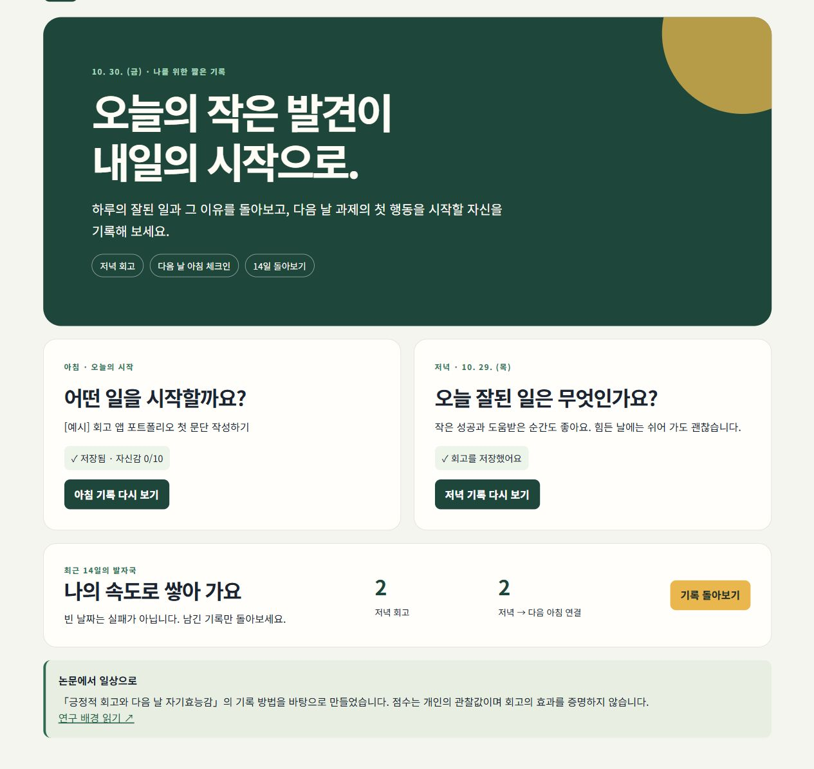

### 저녁 회고 · 사건·이유·기여 태그

잘된 일과 그 이유를 한 항목씩 작성하고 ‘내 행동·타인의 도움·상황/운’ 태그를 선택합니다. 사건 10자 이상과 이유를 갖춘 두 항목을 채우면 완료할 수 있으며, 세 번째 항목은 선택입니다.

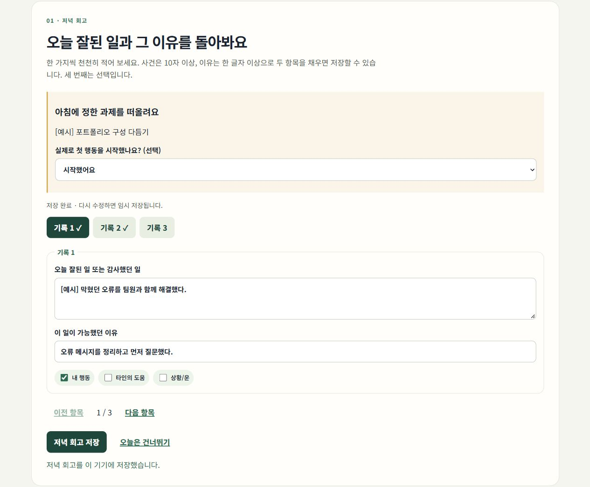

### 아침 체크인 · 과제와 시작 자신감

중요한 과제와 **첫 행동을 시작할 자신감**을 0–10점으로 기록합니다. 긍정·부정 정서, 예상 난이도와 선택적 수면 시간도 남길 수 있으며, 0점은 미입력과 구분해 저장합니다.

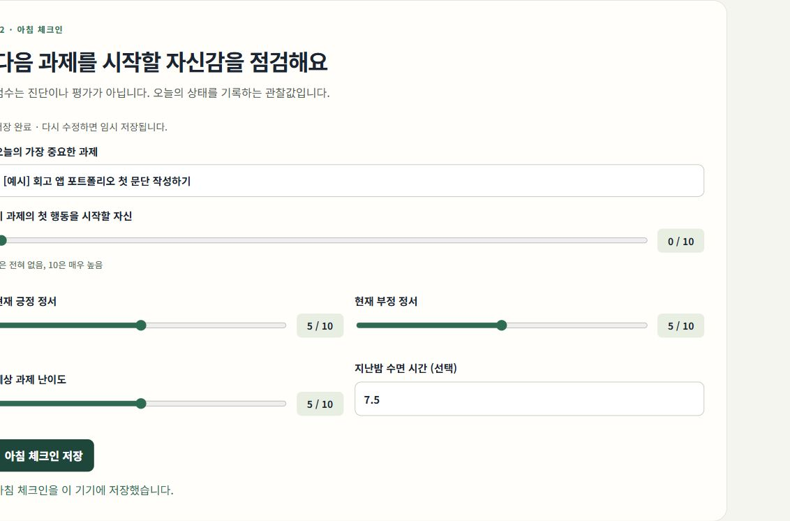

### 아침 목표 되돌아보기 · 실제 시작 여부

저녁에 그날 아침의 과제를 다시 보여 주고 실제로 첫 행동을 시작했는지 선택적으로 기록합니다. 예상한 자신감과 실제 행동에 관한 자기보고를 따로 보관합니다.

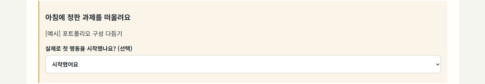

### 자동 임시 저장 · 새로고침 후 이어 쓰기

입력 중인 내용을 자동으로 임시 저장해, 새로고침한 뒤 같은 날짜를 열어도 이어 쓸 수 있습니다. 명시적으로 저장하기 전까지는 완료 기록으로 집계하지 않습니다.

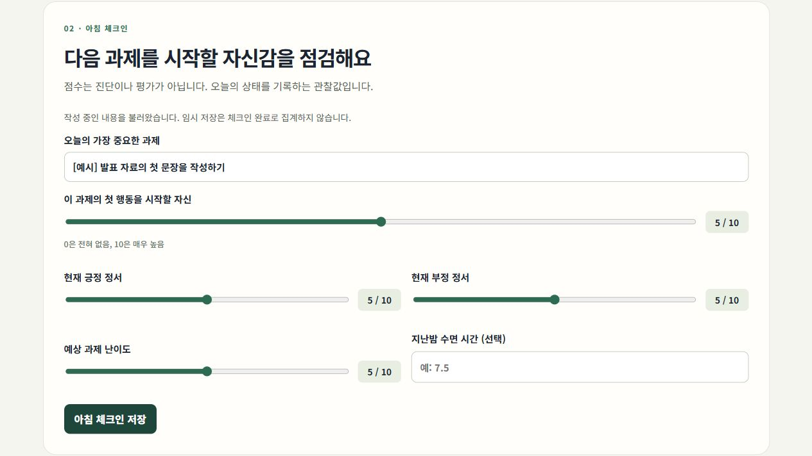

### 날짜 연결과 상세 기록 · 저녁 D → 아침 D+1

선택한 날짜의 저녁 회고와 다음 날 아침 자신감을 함께 확인합니다. 새벽 02:00까지는 전날 저녁을 기본 날짜로 선택하며, 상세 화면에서 해당 날짜의 아침·저녁 기록을 수정할 수 있습니다.

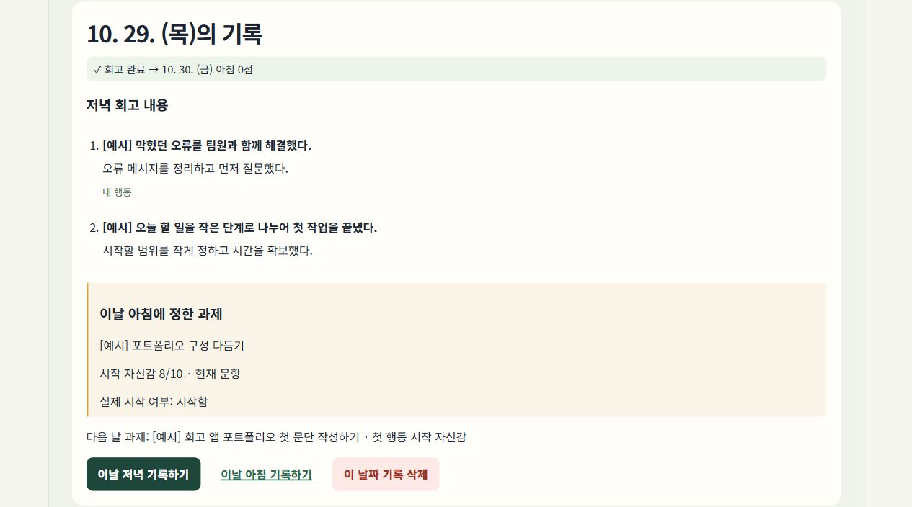

### 14일 자신감 그래프 · 누락과 문항 버전 구분

14개의 실제 날짜를 기준으로 아침 자신감을 보여 줍니다. 누락 구간은 선을 끊고, 이전 문항은 마름모·점선, 현재 문항은 원형으로 구분합니다. 서로 다른 버전의 점수 사이도 연결하지 않습니다.

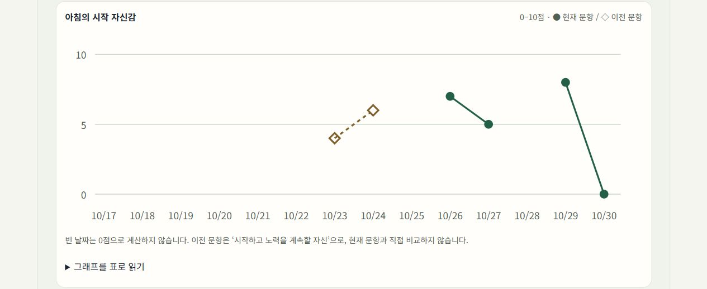

‘그래프를 표로 읽기’를 펼치면 날짜별 점수·미입력 여부·문항 종류를 텍스트로 확인할 수 있습니다.

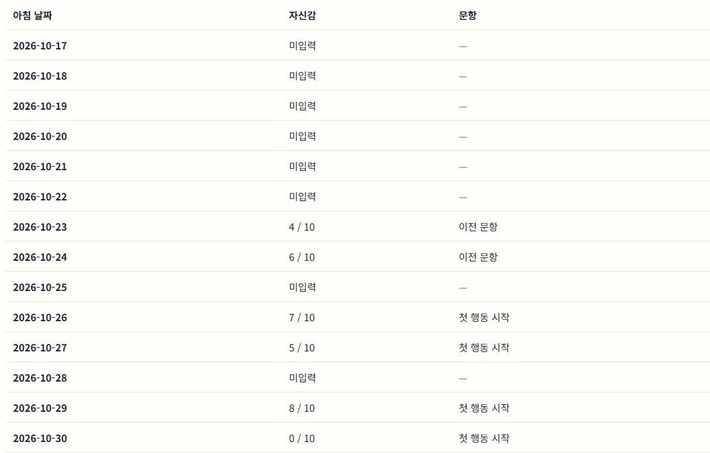

### 기록 달력 · 완료·건너뜀·미입력

최근 14일의 저녁 상태와 그날 아침 점수를 날짜별로 확인합니다. 색상 외에 ‘✓ 회고 완료’, ‘— 건너뜀’, ‘○ 미입력’ 표시를 함께 사용하며, 날짜를 누르면 상세 기록을 보여 줍니다.

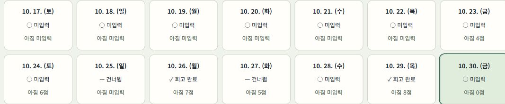

### 전체 기록 검색 · 날짜와 내용으로 찾기

날짜·과제·사건·이유를 대상으로 저장된 전체 기록을 검색합니다. 결과를 선택하면 해당 날짜의 내용을 다시 읽거나 수정할 수 있습니다.

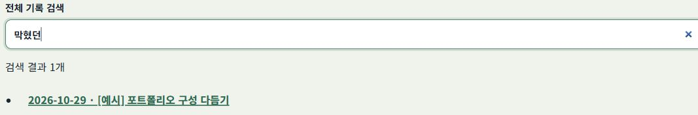

### JSON 백업·CSV 내보내기 · 기록 직접 보관

JSON은 작성한 내용과 임시 저장을 백업하고, CSV는 저장을 마친 기록을 표로 내보냅니다. CSV에는 전후 날짜 연결과 문항 버전을 포함하며 누락 값은 빈칸으로 남깁니다.

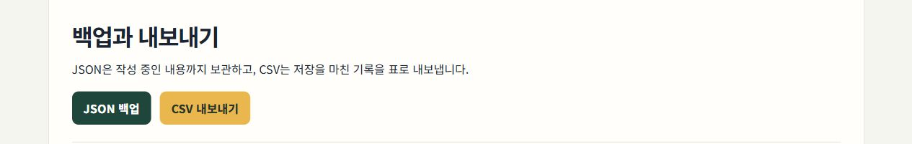

### 백업 복원 · 미리보기 후 병합

파일 형식을 검증하고 기록·임시 저장 개수를 먼저 보여 줍니다. 복원을 확정하면 현재 기록과 합치며, 같은 날짜의 기존 아침·저녁 내용과 임시 저장을 우선 보존합니다.

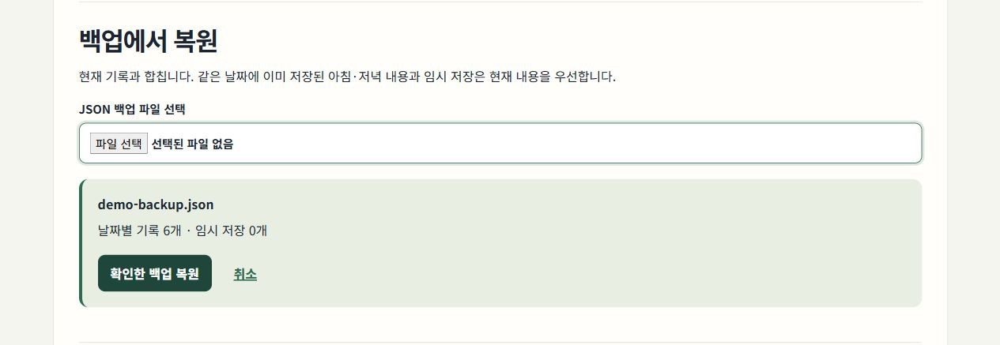

### 입력 오류 안내와 건너뛰기 · 상황에 맞는 기록

필수 내용이 부족하거나 수면 시간이 0–24시간 범위를 벗어나면 입력 내용을 유지한 채 안내를 표시합니다. 회고가 어려운 날에는 건너뛰기를 선택할 수 있으며, 미입력·완료와 별도로 저장합니다.

| 부족한 입력 안내 | 회고 건너뛰기 저장 |
| --- | --- |
| 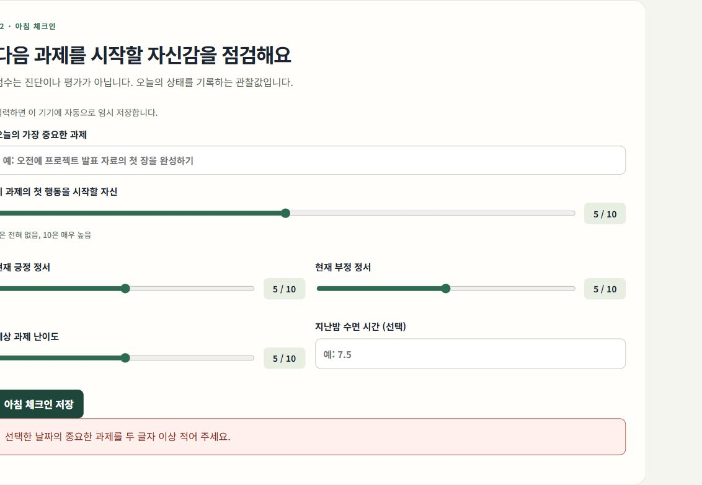 | 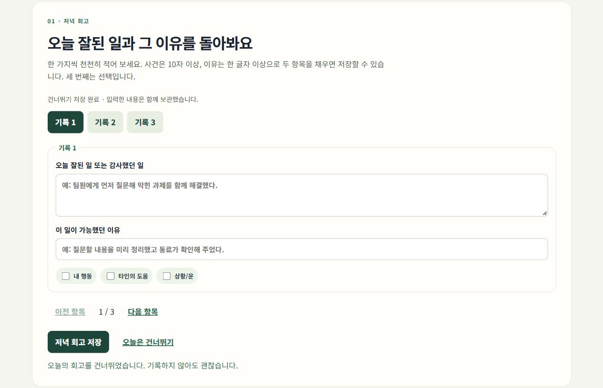 |

### 기록 삭제 · 사용자 데이터 관리

날짜별 상세에서 선택한 날짜의 아침·저녁 기록을 삭제하거나, 설정에서 기록과 임시 저장을 전체 삭제할 수 있습니다. 삭제 전 확인창을 거치며 필요한 내용을 먼저 백업하도록 안내합니다.


## 모바일 화면

좁은 화면에서는 카드와 입력 영역을 세로로 배치하고 달력 열 수를 줄입니다. 그래프 내부에 가로 스크롤을 제공해 페이지 전체의 가로 넘침을 방지했습니다.

| 모바일 홈 | 모바일 돌아보기 |
| --- | --- |
| 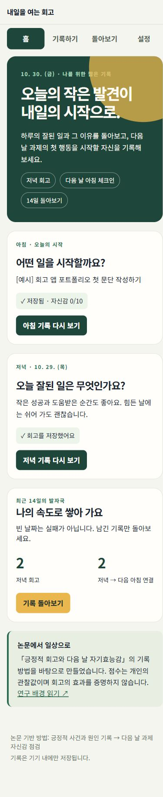 | 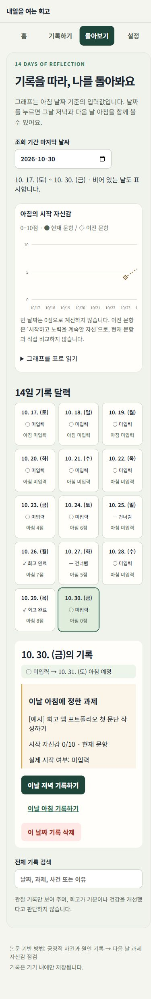 |

## 함께 작성한 연구 논문

「대학생의 저녁 긍정적 회고와 다음 날 과제 시작 자기효능감의 시간적 연관성」을 **30페이지의 문헌고찰·연구 프로토콜**로 작성했습니다. 도식·이미지 7개, 표 11개, 참고문헌 11편과 부록을 포함하며, 연구 질문과 기록 절차를 앱의 문항·날짜 연결·데이터 구분에 반영했습니다.

실증자료 수집과 효과 검증은 후속 연구 범위입니다.

[논문 웹판](https://positive-reflection-research-paper.vercel.app/) · [논문 PDF](https://positive-reflection-research-paper.vercel.app/paper.pdf) · [논문 소스](https://github.com/gyeonggumun/positive-reflection-research-paper)

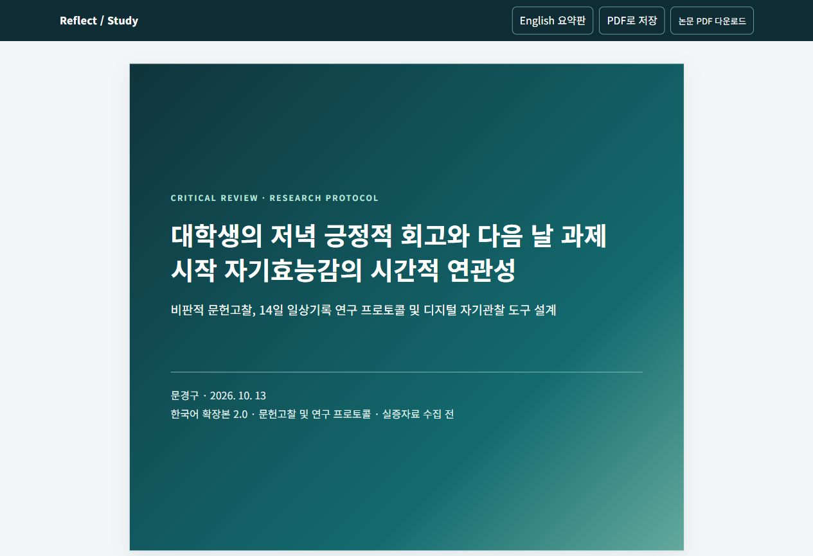

## 실행 방법

Node.js 20.19 이상이 필요합니다.

```bash
npm install
npm run dev
```

표시된 로컬 URL을 브라우저에서 엽니다. 배포용 결과물은 다음 명령으로 만들 수 있습니다.

```bash
npm run build
```

## 확인 방법

1. 홈에서 오늘의 아침·저녁 상태와 연구 배경 링크를 확인합니다.
2. 회고 두 항목에 10자 이상의 사건과 이유를 입력합니다. 부족하면 오류 안내를 표시합니다.
3. 아침 과제와 자신감 점수를 기록합니다. 0점도 유효한 값이며 수면은 0–24시간 또는 빈칸입니다.
4. 돌아보기에서 저녁 날짜와 다음 날 아침 연결, 누락 날짜, 현재·이전 문항의 다른 표시를 확인합니다.
5. 설정에서 JSON 백업을 내려받고 파일을 선택해 미리보기 후 복원합니다. 기존 섹션은 우선 보존합니다.

```bash
npm test
npm run build
```

GitHub Actions는 push와 PR에서 같은 테스트·빌드를 수행합니다. Vercel은 연결된 저장소의 main push로 자동 배포됩니다.

## 예시 기록으로 둘러보기

`docs/examples/demo-backup.json`은 캡처·기능 확인용 **가상 기록**입니다. 앱의 설정 → JSON 백업 파일 선택 → 미리보기 → 복원으로 불러올 수 있습니다. 자동 삽입하지 않으며, 실제 연구 데이터가 아닙니다.

## 저장과 날짜 규칙

- 날짜는 실행 기기의 현지 날짜입니다. 작성 날짜와 실제 저장 시각(UTC), 저장 당시 시간대 오프셋을 별도 보관합니다.
- 기존 v1 기록의 날짜와 문항은 이동·추정하지 않습니다. v2에 정상 저장한 뒤 이전 키를 정리합니다.
- 임시 저장은 완료 기록과 분리됩니다. 명시적으로 저장하거나 건너뛰어야 상태가 확정됩니다.
- JSON은 전체 내용과 임시 저장을 보관합니다. CSV의 `date`는 해당 날짜의 기록이며 `previous_evening_*`, `next_morning_*` 열로 전후 연결을 명시합니다.
- 이전 문항은 `legacy-start-and-persist`, 현재 문항은 `initiation-v2`로 구분합니다. 누락은 빈칸, 실제 0점은 0입니다.
- 손상 데이터를 읽으면 원본을 보호하고 저장을 차단합니다. 다른 탭에서 내용이 바뀌면 오래된 탭의 덮어쓰기를 막습니다.

## 개인정보와 해석 원칙

이 앱은 의료적 진단·치료·위기 대응 서비스가 아닙니다. 기록은 기본적으로 사용자의 브라우저에만 저장되며, 앱은 회고가 기분이나 건강을 개선했다고 판단하지 않습니다. 실제 개인정보·API 키·외부 AI 서비스 키를 사용하지 않습니다.

## 개발 방식

AI를 활용해 React 컴포넌트, 입력 검증, 로컬 저장과 파일 내보내기 초안을 구현하고 테스트와 브라우저 확인으로 보완했습니다. 사용자 흐름, 연구 문항과 날짜 연결 기준, 개인정보 최소화 방향을 정하고 결과를 검토했습니다.

기능별 화면과 설계 의도는 [포트폴리오](PORTFOLIO.md)에 정리했습니다.
