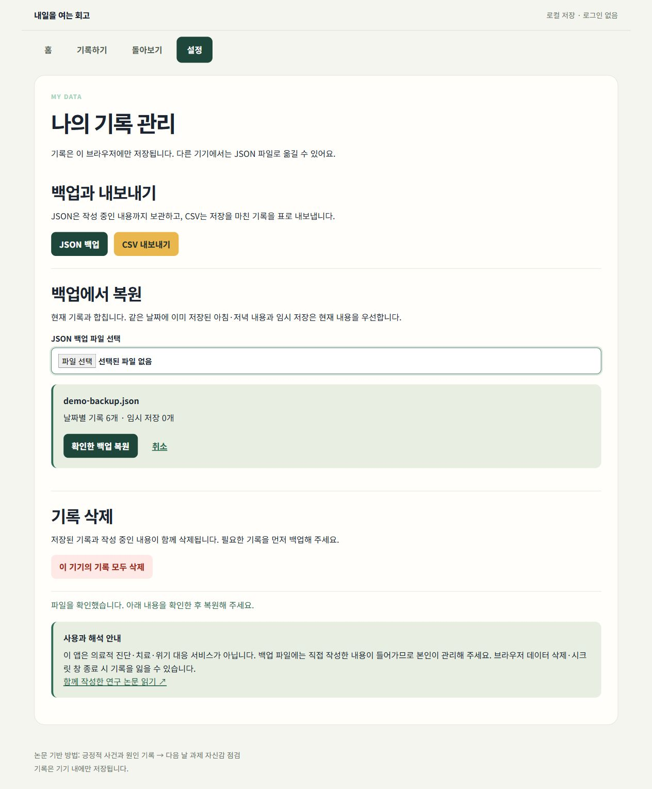

# 회고 앱 고도화 검증 기록

검증일: 2026. 10. 30. · 검증 대상: React 개인 회고 앱

검증 흐름은 **화면 입력 → 브라우저 저장 → 새로고침·조회 → 파일 백업·복원**입니다. 이 앱은 정적 프런트엔드이며 API 서버나 외부 데이터베이스를 사용하지 않습니다.

## 자동 테스트

`npm test`로 다음 8개 테스트를 통과했습니다.

| 영역 | 확인한 내용 |
| --- | --- |
| 날짜 경계 | 자정·02:00 경계, 월말·윤년·연말, 불가능한 날짜 |
| 다음 날 연결 | 같은 날 아침이 아닌 다음 날 아침 선택, 0점과 미입력 구분 |
| 이전 저장소 | v1 읽기는 원본 보존, 정상 쓰기 후 v2 전환, 날짜·문항·0점 보존 |
| 손상 데이터 | 손상된 원본을 빈 기록으로 덮어쓰지 않음 |
| 쓰기 실패 | 용량 부족 오류와 오래된 탭의 쓰기 거부, 기존 내용 유지 |
| 백업 병합 | JSON 왕복, 현재 섹션·임시 저장 우선, 누락 섹션 보충 |
| 파일 검증 | 다른 앱의 파일·중복 날짜·범위 밖 점수·잘못된 태그 거부 |
| CSV | 0점·건너뜀·빈칸, 전후 날짜 연결·문항 버전, 수식 형태의 텍스트 처리 |

`npm run build`로 배포용 정적 파일 생성을 확인했습니다. GitHub Actions의 [검증 워크플로](../.github/workflows/verify.yml)는 push·PR마다 같은 명령을 실행합니다.

## 실제 브라우저 확인

로컬 검증용 주소에서 가상 기록만 사용했습니다. 캡처는 [images 폴더](images/)에 보관합니다.

| 동작 | 관찰한 결과 |
| --- | --- |
| 빈 아침 저장 | 과제를 두 글자 이상 입력하라는 오류 안내 |
| 수면 25시간 | 범위 오류 안내, 입력 내용 유지 |
| 새로고침 | 작성 중 과제·0점·입력한 수면 값 복원, 완료와 구분 |
| 유효한 아침 저장 | 성공 메시지 유지, 0점 저장 |
| 부족한 회고 저장 | 두 항목 이상 작성 안내, 화면 유지 |
| 저녁 두 항목 저장 | 날짜 상세에서 사건·이유 표시 |
| 다음 날 연결 | 10/29 저녁 → 10/30 아침 0점 표시 |
| 과제 시작 여부 | 아침 과제 재표시, 저녁에서 시작 여부 선택·저장 |
| 전체 검색 | ‘막혔던’ 검색 시 해당 날짜 1개 표시 |
| 잘못된 JSON | package.json을 거부하고 현재 기록 유지 |
| 정상 JSON | 6개 날짜 기록 미리보기 후 병합, 충돌 날짜 1개 기존 내용 우선 |
| 파일 내보내기 | JSON·CSV 파일 다운로드 완료 |
| 누락과 문항 버전 | 현재 점 4개·이전 점 2개, 인접·동일 문항 구간 3개만 연결 |
| 모바일 | 너비 390px의 테스트 뷰포트에서 문서 가로 넘침 없음, 그래프 내부 스크롤 |
| 콘솔 | 검증 흐름에서 오류 로그 0건 |

### 포트폴리오 기능별 캡처

`images/features/`에 실제 앱의 기능별 화면 15장을 추가했습니다. 홈, 저녁·아침 기록, 과제 시작 여부, 임시 저장 복원, 날짜 상세, 그래프·표·달력, 검색, 파일 내보내기·복원, 오류 안내·건너뛰기·삭제 메뉴를 촬영했습니다.

임시 저장은 새로고침 후 해당 날짜를 다시 열어 복원 안내와 입력 내용을 확인했습니다. 삭제 기능은 메뉴를 촬영했으며 실제 사용자 기록을 삭제하지 않았습니다. 이번 수정은 문서와 이미지에 한정되며, 포트폴리오의 이미지 18개와 로컬 링크가 모두 유효한 것을 확인했습니다.

이미지 일부에서 왼쪽 제목·테두리 잘림을 발견해 README와 포트폴리오에 사용하는 화면 18장을 재촬영했습니다. 기능 화면은 좌우 전체 폭을 포함하고, 논문은 표지 하단까지 담았습니다. 모바일은 가로 스크롤 중인 그래프 대신 홈·아침 체크인 전체 화면을 사용했습니다.

## 논문 연결 확인

[논문 웹판](https://positive-reflection-research-paper.vercel.app/)에 실제로 접속해 표지, ‘실증자료 수집 전’ 표시, PDF 다운로드 링크, 그림 7개와 표 11개를 확인했습니다. 논문과 앱의 기여는 연구 설계·제품 구현이며, 참여자 실험이나 효과 검증 완료를 뜻하지 않습니다.

## 배포 확인

GitHub main push에 연결된 Vercel 자동 배포를 확인했습니다.

| 항목 | 확인 결과 |
| --- | --- |
| 공개 주소 | [내일을 여는 회고](https://retrospective-that-opens-up-tomorro.vercel.app/) |
| 검증한 구현 버전 | `b20afec59ae1d67a6ecb94941f301798a2f47a0f` |
| Vercel | `READY` · production · `source: git` · main |
| 배포 ID | `dpl_8Gou1Ag49pURAcd5uzFCq1at6K1j` |
| 빌드 소요 | 약 6.6초 (buildingAt → ready) |
| GitHub Actions | [회고 앱 검증 #1 성공](https://github.com/gyeonggumun/retrospective-that-opens-up-tomorrow/actions/runs/40900522644) |
| 공개 화면 | 홈·설정·JSON 파일 선택·그래프 1개·달력 14일 표시 확인 |
| 배포 자산 | 공개 페이지가 로컬 빌드와 같은 `/assets/index-DvAnvWfW.js` 로드 |
| 배포 후 오류 확인 | 브라우저 콘솔 오류 0건; 서버 함수가 없는 정적 앱이므로 함수 런타임 로그는 검증 대상에 해당하지 않음 |

위 버전에 대한 검증 결과를 문서로 남겼습니다. 이후 문서 변경도 동일한 push → 검증·배포 흐름을 사용합니다.

## 범위와 한계

- 자동 테스트의 저장 실패·손상·다른 탭 충돌은 메모리 저장소 모형으로 재현했습니다.
- 단일 모바일 뷰포트 확인이며, 모든 실기기·보조기기의 인증 테스트를 의미하지 않습니다.
- 삭제는 확인창을 거치는 기능입니다. 캡처 과정에서 사용자 기록을 삭제하지 않았습니다.
- 실험 참가자 자료, 심리적 효과, 사용 시간 개선률은 수집·산출하지 않았습니다.
